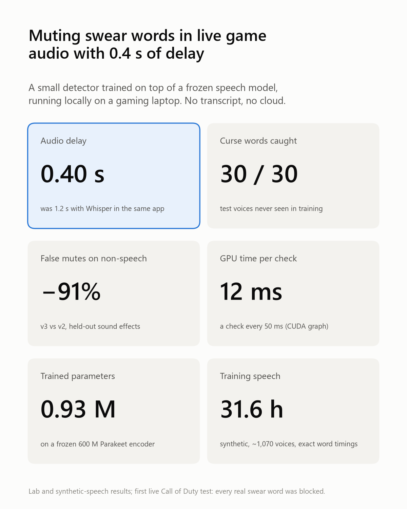
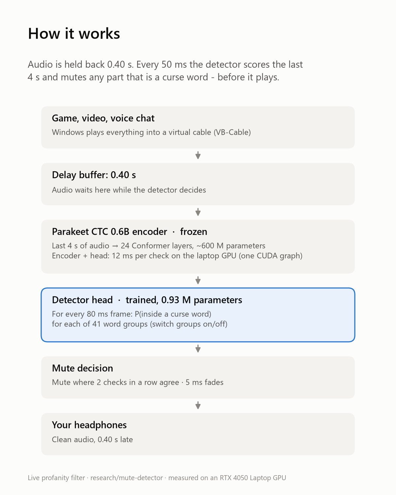
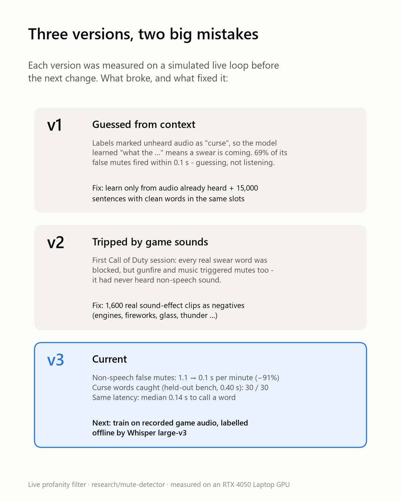
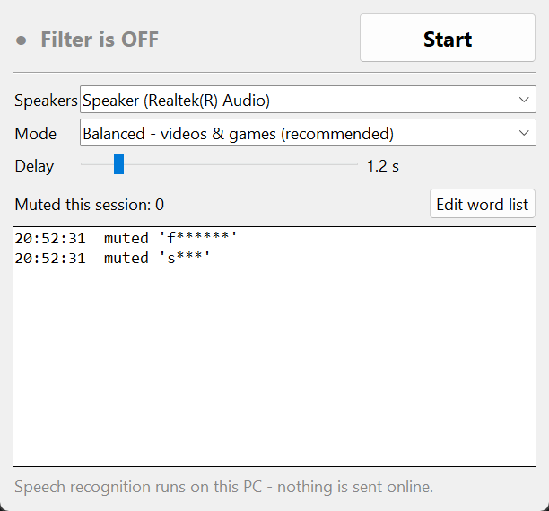

# Audio Censor

Mutes curse words in **everything your Windows PC plays** (YouTube, video players, games, voice chat) before the sound reaches your speakers.

Audio is held back by about a second. Meanwhile [Whisper](https://github.com/SYSTRAN/faster-whisper) transcribes it on your GPU, and any word from your list is replaced with silence. Everything runs locally. No audio leaves your PC.

```
Apps / browser / games
        │   (Windows default output = "CABLE Input")
        ▼
  VB-Audio Virtual Cable
        │
        ▼
  Audio Censor ── ring buffer, delayed ~1.2 s
        ├─ Whisper transcribes the last 4 s every 0.4 s (GPU, word timestamps)
        ├─ words matching words.txt → silence that time range (+ small padding, 5 ms fades)
        ▼
  Your real speakers / headphones
```

## Experimental: Ultra-low lag mode (this branch)

On `research/mute-detector` the app has an extra mode with **0.40 s of delay instead of 1.2 s**. It doesn't transcribe at all: a small detector (0.93 M parameters), trained here on top of a frozen [Parakeet](https://huggingface.co/nvidia/parakeet-ctc-0.6b) speech encoder, scores every 80 ms of audio for curse words, with a check every 50 ms (12 ms each on an RTX 4050 laptop).

<p>



</p>

To try it:
1. Install the lab environment (see [docs/mute-detector.md](docs/mute-detector.md#7-reproduce)).
2. Start **`app-lab.bat`** and choose **"Ultra-low lag - trained detector (experimental)"**.

The mode uses **v4**, trained on synthetic speech plus real public YouTube speech. On a test set of 450 real curse words from 306 videos, at 0.40 s of delay:

| | Curse words silenced | Clean words left intact |
|---|---|---|
| **v4 (this mode)** | **93%** | **95%** |
| Whisper `small.en` (the normal mode's engine) at the same 0.40 s | 15% | 99% |
| Whisper `small.en` at 1.2 s (the normal mode) | 90% | 96% |

Details: [docs/real-speech.md](docs/real-speech.md).

It's still experimental, and it hasn't been measured on game audio. The full write-up covers how the training data was made, every result, what went wrong and what's next: **[docs/mute-detector.md](docs/mute-detector.md)**.

## Requirements

- Windows 10/11
- Python 3.10+
- [VB-Audio Virtual Cable](https://vb-audio.com/Cable/), a free virtual audio driver (donationware, not bundled here)
- An NVIDIA GPU is strongly recommended. Without one it falls back to the CPU, which needs a bigger delay.

## Install

1. Install **VB-Cable**: download it from https://vb-audio.com/Cable/, unzip it, right-click `VBCABLE_Setup_x64.exe`, choose **Run as administrator**, then click **Install Driver**.
   Windows may make "CABLE Input" your default device afterwards, which mutes your normal sound. The app switches it back.
2. Clone this repo and double-click **`install.bat`**. It creates a virtual environment, installs the packages (about 1.5 GB including the NVIDIA CUDA libraries) and adds an **Audio Censor** shortcut to your Desktop.

The speech model downloads automatically from Hugging Face on first start: 75 MB to 1.6 GB, depending on the mode.

## Use

Open **Audio Censor** from the Desktop and press **Start**.



- **Speakers**: where the filtered sound goes. Pick your headphones here if you use them.
- **Mode**:
  | Mode | Model | Delay | GPU use* | Best for |
  |---|---|---|---|---|
  | Balanced (default) | `small.en` | 1.2 s | ~37% | videos and most games |
  | Low lag | `tiny.en` | 0.8 s | ~18% | games |
  | Most accurate | `large-v3-turbo` | 1.5 s | ~67% | videos only |

  \*Measured on an RTX 3070 Laptop GPU.
- **Delay**: fine-tune it. If the log ever says `LATE`, move the slider up.
- **Edit word list**: opens [`words.txt`](words.txt). Use one word per line, and `*` as a wildcard (`fuck*` also matches *fucking* and *fucker*). Restart the filter after editing.

The log shows muted words masked (`f******`). Stop, or simply closing the window, gives your normal speakers back.

**If your sound is ever silent** (for example after a crash), run `restore-sound.bat`.

### Command line

```
start.bat                       # same filter, no window
start.bat --model tiny.en --step 0.3 --delay 0.8
start.bat --output Headphones   # choose the speaker by name
start.bat --verbose             # print everything that is transcribed
```

## Things to know

- **Video sync:** The picture runs ahead of the sound by the delay. In VLC you can fix this with *Tools → Track Synchronization → Audio delay* set to a negative value, such as `-1.200 s`. Browsers can't be corrected.
- **Games:** All game audio is delayed, not just speech. Use **Low lag** mode, or turn the filter off for competitive games.
- **Accuracy:** Clear speech works well. Loud music, heavy accents, crosstalk and mumbling will let some words through.
- **Collateral:** A short word right next to a curse word ("you" in "you a**hole") may be partly cut. The padding is tuned to the smallest value that let nothing leak in testing.

## How it was tuned

`bench.py` replays text-to-speech test clips (normal, fast, and mixed with noise and music) through the same windowed loop on a simulated clock, with real GPU timings. For every curse word it measures how much delay would have been needed to silence all of it.

| Model | Check every | ms per check | Words caught | Delay actually needed |
|---|---|---|---|---|
| tiny.en | 0.3 s | 54 | 30/30 | 0.49 s |
| base.en | 0.3 s | 91 | 30/30 | 0.51 s |
| small.en | 0.4 s | 148 | 30/30 | 0.76 s |
| large-v3-turbo | 0.4 s | 266 | 30/30 | 0.88 s |

`bench_padding.py` tunes the silence around each word. `selftest.py` is an end-to-end test: it plays speech into the virtual cable, records the live output and checks each word's loudness. It doesn't re-transcribe the output, because Whisper "hears" an obvious word from context even when it's silent.

```
.venv\Scripts\python selftest.py                                   # Balanced mode
.venv\Scripts\python selftest.py 0.8 --model tiny.en --step 0.3    # Low lag mode
```

These tests use synthetic speech, so real-world accuracy will be lower.

## Files

| File | What it is |
|---|---|
| `app.pyw` | Desktop app (tkinter) |
| `censor.py` | Engine: audio routing, delay buffer, transcription, muting. Also the CLI. |
| `audio_default.ps1` | Lists and switches the Windows default playback device |
| `words.txt` | Words to mute (explicit, by necessity) |
| `install.bat` / `install.ps1` | One-time setup |
| `start.bat` / `restore-sound.bat` | CLI launcher / emergency sound restore |
| `selftest.py`, `bench.py`, `bench_padding.py` | Tests and benchmarks |
| `app-lab.bat` | Starts the app from `.venv-lab`, adding the experimental Ultra-low lag mode |
| `lab/detector/` | The trained detector: data generation, training, evaluation, figures ([docs/mute-detector.md](docs/mute-detector.md)) |
| `docs/` | Research write-ups: [mute detector](docs/mute-detector.md), [low-latency research](docs/low-latency-research.md) |
