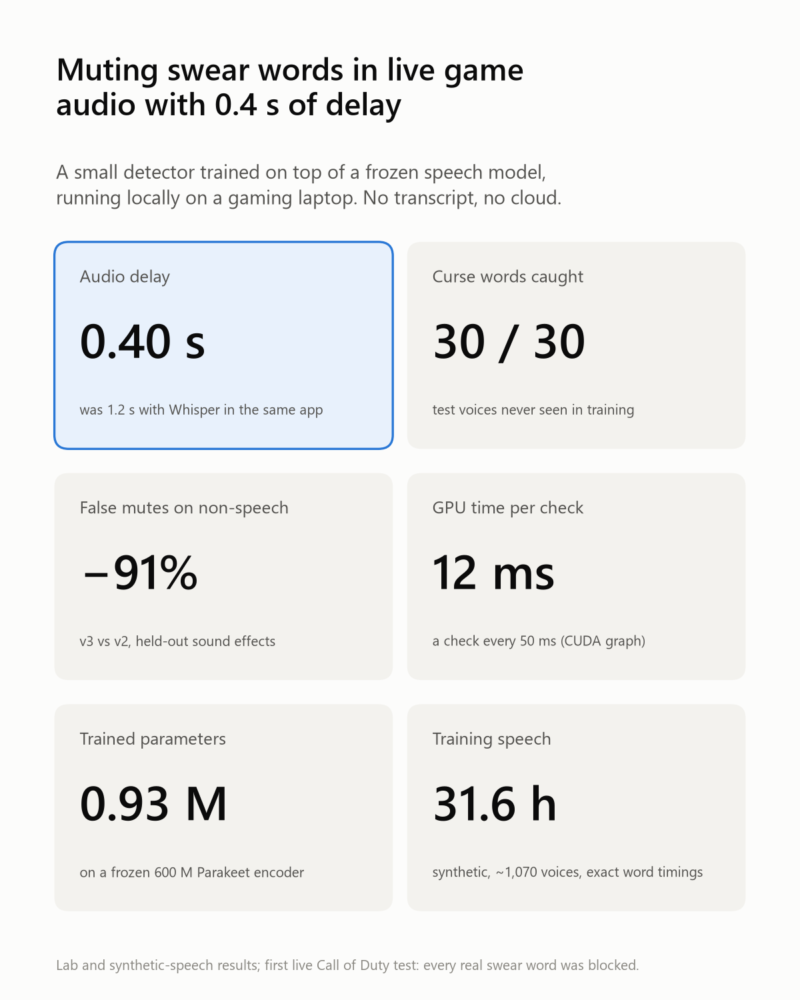
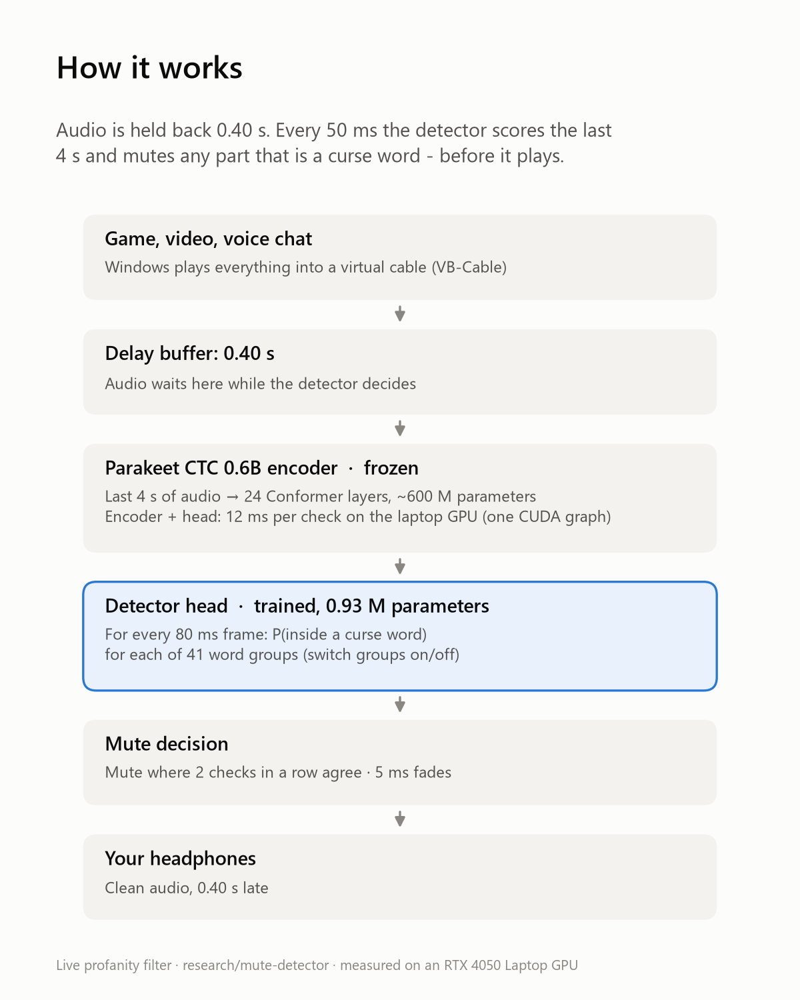
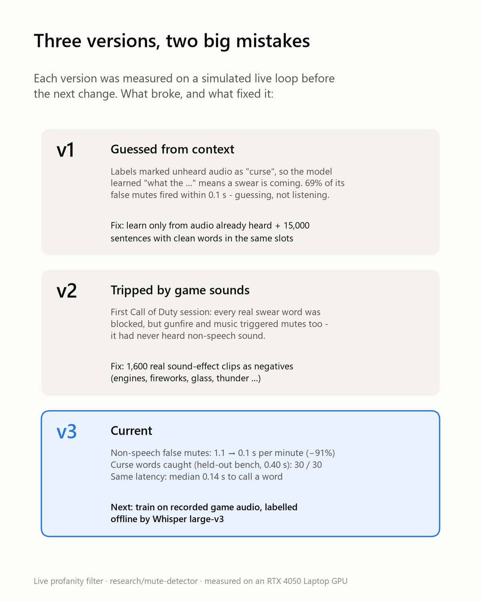

# Mute detector: sub-0.4 s profanity muting (in progress)

**Goal:** keep the worst-case audio delay **under 0.4 s** while still silencing every curse word. The app on `main` holds audio back 1.2 s (Whisper `small.en`), or 0.8 s in "Low lag" mode. [low-latency-research.md](low-latency-research.md) got Parakeet CTC down to about 0.5–0.65 s. Every transcribe-then-match approach waits until a word has been fully recognised, so this branch trains a model that answers one question for each 80 ms frame: *is this part of a curse word?* No transcript is involved.

<p>



</p>

More figures: [latency](images/03-latency.png) · [training data](images/04-training-data.png) · [CUDA graph](images/06-cuda-graph.png). All are 1200×1500 PNGs, rendered by [`figures.py`](../lab/detector/figures.py) from the numbers in this report.

**Update (2026-11-06): real speech and v4. See [real-speech.md](real-speech.md).**
- There is now a test set of 450 real curse words from 306 public YouTube videos (YODAS2), labelled automatically.
- On real speech at 0.40 s, v3 silences 94% of curse words but clips 18% of clean words.
- Mixing real speech into training (21 runs on a Lambda A10) keeps 93% silenced and clips only 5% of clean words. Muting drops from 9.7 to 3.5 s a minute.
- For comparison, Whisper `small.en` silences 15% at 0.40 s and Parakeet gap-fill 76%.
- The app now uses **v4** (`detector-v4.pt`, threshold 0.7, 0.40 s).
- The rest of this report is about v1–v3 and synthetic speech.

**Update (later on 2026-11-04):**
- In a first Call of Duty session, v2 blocked every real swear word but fired often on game sound.
- **v3**, trained with sound effects as negatives, mutes 91% less on held-out non-speech audio.
- The app now uses **v3 at 0.40 s**. See "First game test" and "v3" in section 4.

**Status (2026-11-04, v2):**
- On held-out synthetic voices, the trained detector (v2) silences **234/235 curse words at a 0.40 s delay** (233 at 0.35 s). Each check costs **12.8 ms** on an RTX 4050 Laptop GPU.
- It is in the desktop app as an **experimental** mode, for live testing. It is **not ready to replace the default**: it still mutes about 1 in 5 sound-alike words ("duck", "count", …). It also clips 7.5% of clean words, against 5–8% for Whisper `small.en`.
- Every result so far comes from text-to-speech. Nothing has been measured on real speech yet.

All numbers below were measured on an **RTX 4050 Laptop (6 GB)**, i5-14500HX, 32 GB RAM. The figures in `low-latency-research.md` came from an RTX 3070.

---

## 1. Baseline on this machine

The `bench.py` clips (SAPI voices David and Zira, 30 curse words in total, normal, fast and noisy versions) replayed through the live loop.

| Approach | Step | ms / check | Safe delay (worst word) |
|---|---|---|---|
| Whisper `small.en` (app default) | 0.4 s | 145 | 0.77 s |
| Whisper `tiny.en` (app "Low lag") | 0.3 s | 63 | 0.49 s |
| Parakeet CTC 0.6B gap-fill, eager | 0.1 s | 45–68 | 0.66 s |
| Parakeet gap-fill, **CUDA graph** | 0.05 s | **15.6** | 0.64 s |
| Parakeet gap-fill, CUDA graph | 0.03 s | 15.5 | 0.84 s |

**CUDA graphs cut a Parakeet call from about 50 ms to about 12 ms** at any window length from 1 to 4 s ([`probe_speed.py`](../lab/detector/probe_speed.py)). Eager mode is dominated by kernel-launch overhead.

**A shorter step did not lower the delay.** Per word, Parakeet with graphs at a 0.05 s step catches 28 of 30 words within 0.4 s of onset (median 0.27 s). The worst case comes from two words. "dickhead" needed 0.64 s in the clean clip but 0.38 s in the identical noisy clip, and "crap" needed 0.48 s. The greedy transcript flickers at the window edge. Transcribing faster doesn't fix that; a different kind of model is needed.

## 2. The detector

```
16 kHz audio, last 4.0 s ──► log-mel (GPU) ──► Parakeet CTC 0.6B encoder (frozen, bf16)
                                                   │ outputs of blocks 12, 16, 20, 24
                                                   ▼
                                    learned layer mix → LayerNorm → Linear 1024→256
                                    → 2× Conv1d(k=5) residual → Linear 256→41
                                                   ▼
                                 P(frame is inside curse word of group g), every 80 ms frame
```

- **Parameters:** about 600M in the frozen encoder and **0.93M trained** in the head. GPU memory is about 1.4 GB in training and 1.1 GB in inference.
- **Graph capture:** encoder and head are captured as one CUDA graph with a fixed 4 s window (zero-padded on the left at stream start). A check costs **12.8 ms on average, 16 ms at p99**, including the GPU feature extraction. That reimplements `ParakeetFeatureExtractor` without its numpy padding and matches it to within bf16 rounding.
- **One output per word group (41 groups).** The app will be able to switch categories on and off without retraining. The categories are strong, British, slurs and mild.
- **Live decision rule:** every 0.05 s, mute any heard frame where the maximum over enabled groups exceeds a threshold *in 2 consecutive checks*. The second check filters one-off spikes and costs 0.05 s.

## 3. Training data

No public dataset labels curse words frame by frame, so the data is synthetic. It was generated with **[Piper](https://github.com/OHF-Voice/piper1-gpl) TTS**, which reports how many samples each phoneme gets. Word boundaries are therefore **exact**, with no forced aligner.

**Vocabulary** ([`lexicon.py`](../lab/detector/lexicon.py)):
- **41 groups and 268 curse forms**: inflections, compounds such as "motherfucking" and "half-assed", and phrases such as "what the fuck", where only the curse word is labelled.
- **345 negatives that must stay audible.** These are sound-alikes ("duck", "count", "class", "hello", "Niger", "shift" …) and minced oaths ("freaking", "frick", "shoot", "heck" …).
- `words.txt` was extended to match. `lexicon.py` checks that every curse form is caught and that no single-word negative is.

**Sentences** ([`corpus.py`](../lab/detector/corpus.py)) come in four kinds:
- curse words in natural slots ("What the ___", "such a ___") or dropped into about 130 everyday carrier sentences
- **context negatives**: the same slots filled with clean words ("What the heck", "such a legend")
- sound-alike negatives
- clean carriers

Common words get more examples (f-word and s-word ×4; ass, b-word, damn and hell ×3).

**Voices:** all 29 English Piper voices, about 1,070 speakers. These include LibriTTS-R (904 speakers), VCTK (109, British), L2-ARCTIC (24, non-native accents) and ARCTIC (18). Speech rate and expressiveness are randomised for every sentence.

| Split | Sentences | Hours | Notes |
|---|---|---|---|
| `train` | 40,000 | 24.5 | 20,371 with curse words |
| `train_ctx` | 15,000 | 7.1 | context negatives only (added for v2) |
| `test` | 2,000 | 1.1 | 989 with curse words; **voices and speakers never seen in training** |
| `test_ctx` | 1,000 | 0.4 | context negatives, held-out voices |

**Held out:**
- whole voices: `ryan`, `alba`, `kristin`
- the last speakers of each multi-speaker voice: LibriTTS-R from 850, VCTK from 100, L2-ARCTIC from 20, ARCTIC from 16
- the bench clips' SAPI voices, which belong to a different TTS engine altogether

**Label accuracy:**
- After a pause, Piper's word starts sit **within 6 ms of the energy onset** (median), and word ends 27 ms after it.
- Whisper's word timestamps start about 50 ms early. The bench, which uses Whisper references, is therefore slightly pessimistic.

**Augmentation**, applied as training examples are built:
- noise (white, pink or brown) at 0–25 dB SNR
- synthetic music and chords
- babble from other clean sentences at 6–25 dB
- room reverb (RT60 0.15–0.7 s)
- telephone band-pass
- random gain

**Training examples:** each one is a 4 s window cut from 2–3 joined sentences. 60% of windows end just before, inside or shortly after a curse word, because that is where the early decision is made.

Generating the 40,000 sentences took about 30 minutes on 12 CPU workers. Training ran at batch 32: about 16 minutes for v1 (6,000 steps) and 20 minutes for v2 (8,000 steps).

## 4. Results

The evaluation is [`eval.py`](../lab/detector/eval.py). It replays long streams through the live loop on a simulated clock, with real GPU timings, and scores by **loudness**:
- a curse word is *silent* when less than 20% of its level remains
- a clean word is *intact* when more than 70% remains
- the *needed delay* is the smallest delay at which every 10 ms of the word is muted before it plays

### v1: learned to guess from context

| Threshold, rule | Held-out voices: silent at 0.40 s | Clean intact | Muted per minute |
|---|---|---|---|
| 0.7, any single check | 234/235 | 80.7% | 11.6 s |
| 0.7, 2 checks in a row | 226/235 | 96.6% | 6.5 s |

Needed delays were suspiciously low, a median of 0.03–0.13 s. [`diag_fp.py`](../lab/detector/diag_fp.py) found the cause:
- **69% of false mutes fired within 0.1 s of the audio being heard.**
- The words hit almost all followed "the", "a", "this", "that" or "oh": exactly the curse-template contexts.

The labels had marked as "curse" the *whole* curse word that a frame overlapped, including audio not yet heard. The model learned to predict a curse word from "What the …" before hearing it.

### v2: fixes

**Labels:** a frame is positive only once **20 ms of the curse word inside it has been heard**. Before that, the frame is left out of the loss. **Data:** the 15,000 context-negative sentences were added.

| Threshold, rule | Held-out voices: silent at 0.35 / 0.40 s | Clean intact | Sound-alikes intact | Context set: clean intact | Context set: muted | Bench (SAPI): silent at 0.40 s | Bench: clean intact |
|---|---|---|---|---|---|---|---|
| 0.5, 1 check | 235 / 235 | 76.7% | 58% | 72.4% | 9.1 s/min | 27/30 | 81.9% |
| **0.5, 2 checks** | **233 / 234** of 235 | **92.5%** | **81%** | **87.2%** | **4.1 s/min** | **27/30** | **94.2%** |
| 0.7, 2 checks | 225 / 227 | 96.5% | 89% | 92.6% | 2.4 s/min | 26/30 | 97.8% |
| 0.85, 2 checks | 206 / 209 | 98.3% | 94% | 96.4% | 1.2 s/min | 25/30 | 99.2% |

At **0.5 with 2 checks**, the needed delay on held-out voices is **0.18 s at the median and 0.39 s at p95**.

**The 3 bench "misses" are word onsets, not missed words.** The first 60–70 ms of "shit" (the "sh" sound) and a little of "crap" go unmuted; the rest of each word is silenced. Some of that gap is the Whisper reference running early. A 60 ms pre-pad, the same as Whisper mode uses, is being evaluated:

| v2, 2 checks, pads 0.06 / 0.02 s | Held-out voices: silent at 0.35 / 0.40 s | Needed delay median / p99 / max | Clean intact | Sound-alikes intact | Context set: muted | Bench: silent at 0.35 / 0.40 s | Bench: clean intact |
|---|---|---|---|---|---|---|---|
| threshold 0.5 | **235 / 235** of 235 | 0.14 / 0.32 / **0.40 s** | 85.5% | 71% | 6.8 s/min | 28 / **29** of 30 | 87.1% |
| threshold 0.6 | 233 / 233 | 0.16 / 0.51 / 0.65 s | 90.1% | 78% | 5.1 s/min | 27 / 28 | 90.1% |

The pre-pad closes the onset leaks: every held-out word is silenced at 0.35 s, the worst case drops from 1.02 s to 0.40 s, and the bench reaches 29/30. The cost is about 7 points of clean speech (92.6% to 85.5% intact). The app's experimental preset uses threshold 0.5, pads 0.06/0.02 and a delay of 0.35 s: for live testing, a clipped word is better than a leaked one. Better boundaries (next steps, item 1) should recover the collateral.

**Where v2 stands against the app today:** Whisper `small.en` at 1.2 s silences 30/30 bench words with about 92% of clean words intact. v2 at 0.4 s delays audio a third as long, with comparable collateral on the bench. It still has two weaknesses: onset leaks, and roughly 1 sound-alike in 5 muted.

### In the app

The detector is in the desktop app as **"Ultra-low lag - trained detector (experimental)"**: delay 0.35 s, threshold 0.5, pads 0.06/0.02, 2 checks in a row. Start the app with **`app-lab.bat`**, which uses `.venv-lab`; the mode is only listed when torch and `lab/detector/models/detector-v2.pt` are present. From the command line, use `censor.py --model detector` (optionally with `--delay`, `--threshold` and `--pads`). Comment a word out of `words.txt` and its whole group stops being muted.

[`live_sim.py`](../lab/detector/live_sim.py) runs the app's real engine (`Censor.detect_forever` on its own thread, 10 ms blocks at real-time pace) with no audio devices. On `selftest.py`'s speech (a SAPI voice) at 0.35 s:
- all 6 curse words are silent, each muted with **0.11–0.18 s to spare**
- 48 of 55 clean words are intact
- "boss", "hard" and "good" are fully muted; the last two sit right next to curse words

Gaming caveats:
- A game shares the GPU, so a check can take longer than 12 ms. If the log shows `LATE`, raise the delay.
- The detector uses about 1.1 GB of VRAM.

### First game test: Call of Duty MW4 (v2, 0.35 s)

- **Every real swear word was blocked.**
- **Too many false positives:** about 300 mutes in 16 minutes, many in slur groups nobody said. The model was reacting to game sound (gunfire, explosions, music), which it had never heard: all its training audio was synthetic voices over simple synthetic noise.
- **About 3 in 4 mutes were marked `LATE`.** The app now logs check timings every 30 s, so the next session will show whether the game is starving the GPU.

### Speech gate (tried, not used)

A frame may only be muted where Parakeet's own CTC layer hears speech (P(non-blank) > S within K frames). Parakeet's CTC output only commits near the end of a word, so the gate makes curse words late. Results on v2 at threshold 0.5, 2 checks, 0.35 s; non-speech = ESC-50:

| Gate | Non-speech muted | Held-out voices silent | Clean intact |
|---|---|---|---|
| off | 1.2 s/min | 235/235 | 85.4% |
| K=2, S=0.5 | 0.0 s/min | 210/235 | 93.4% |
| K=3, S=0.3 | 0.1 s/min | 224/235 | 90.1% |
| K=5, S=0.3 | 0.2 s/min | 228/235 | 87.5% |

It is still available (`--gate K:S`), but off by default.

### v3: sound effects as negatives

The v2 recipe, plus **ESC-50** environmental sounds (folds 1–4; fold 5 held out for eval) used three ways:
- 15% of training windows are sound effects only, labelled all-clean
- sound effects are one of the background types, at −5 to 20 dB SNR
- sound effects fill some of the gaps between sentences

Threshold 0.5, 2 checks, no gate:

| | v2 | v3 |
|---|---|---|
| **Non-speech (ESC-50 fold 5) muted** | 1.1 s/min | **0.1 s/min** |
| Bench: silent at 0.35 / 0.40 s | 28 / 29 of 30 | 29 / **30** of 30 |
| Held-out voices: silent at 0.35 s | 235/235 | 234/235 |
| Clean intact (held-out voices) | 85.4% | 85.5% |
| Context set: clean intact | 80.8% | 79.0% |

Through VB-Cable (`selftest.py --model detector`), v3 is borderline at 0.35 s: one run left "shit" at 22% loudness, one run left "crap" at 18%. At **0.40 s** two runs were clean: 6/6 at 0% and 0 late. **The app now uses v3 at 0.40 s.** ESC-50 is not game audio, though, so the next CoD session decides.

**Recording mode:** the app's "Save audio for training" checkbox (CLI: `--save DIR`) keeps the incoming audio as 16 kHz FLAC parts plus every mute decision (`mutes.jsonl`) under `data/recordings/`, on this PC only. Game sessions labelled offline by Whisper large-v3 are the next training data.

## 5. Lessons and gotchas

- **Never label unheard audio as positive.** In a streaming detector it teaches guessing from context, and that guessing does not carry over from templated text to real speech.
- **Templated sentences leak context.** Always pair every curse slot with clean words in the same slot.
- **ONNX Runtime oversubscribes the CPU.** Piper creates its session with default options, one thread per core *in every worker*. Twelve workers got almost nothing done in 13 minutes. With `intra_op_num_threads=1` each worker runs at 13× realtime ([`make_tts.py`](../lab/detector/make_tts.py) patches it).
- **espeak merges unstressed function words.** "in the" becomes "ɪnðə" and "could have" becomes one phoneme word, so 10% of sentences failed to line up. `merge_map` now aligns words to phoneme groups by phoneme length, so a merged group covers 1–3 words. The drop rate is now 0. The `train` split was generated before this fix, so it lacks those sentences, which are mostly clean carriers.
- **`np.load(...)["audio"]` re-reads the whole array on every access.** Slicing it per utterance kept hundreds of full copies alive and ran out of memory.
- **`ParakeetFeatureExtractor(device="cuda")` does not accept GPU tensors**, because it pads through numpy. `detector.features` reproduces it for fixed-length batches.
- **Parakeet's step is not its bottleneck.** With CUDA graphs a check costs 12 ms. The remaining delay is how long the model needs to hear the word.

## 6. Next steps

*As of 2026-11-06, item 4 (real-speech test set) and item 5 (real training data) are done. Game audio (item 1) is no longer used for training, after the 2026-11-05 decision to use public data only. The current list is in [real-speech.md §9](real-speech.md#9-open-items).*

1. **Game audio (next):** play with "Save audio for training" on, then label the recordings offline with Whisper large-v3, using full context and no time pressure. Train v4 on that alongside the synthetic data. ESC-50 isn't gunfire or game music; real sessions are.
2. **Onsets:** settle on the pre-pad, or train the head to also predict a start offset within the frame. Frames are 80 ms, which is coarse, and onsets are why v3 is borderline at 0.35 s.
3. **Precision (v4+):** unfreeze the top 2–4 encoder blocks (about 25M parameters each) with gradient checkpointing, and weight sound-alike and context negatives more heavily in the loss. Regenerate `train` with the `merge_map` fix and the 4-kind sentence mix.
4. **Real speech, needed before any claim:**
   - Build a real-speech test set: People's Speech rows containing curse words (stream only transcripts, then fetch just the matching audio), forced-aligned and spot-checked by ear, plus your own clips kept locally.
   - Add L2-ARCTIC and `ryan` to the test voices; the current 8 test shards missed them by chance.
5. **Real-speech training data:** the same People's Speech pipeline for training, if the synthetic-only model doesn't carry over.
6. **App polish:** the mode, the VB-Cable self-test and live game testing are all done. Still to do: group/category toggles and a threshold slider in the UI.
7. **Smaller and faster (optional):** distil the encoder, or use a smaller one such as Parakeet 110M, so the filter uses less of the GPU while gaming.

## 7. Reproduce

```powershell
python -m venv .venv-lab
.venv-lab\Scripts\python -m pip install torch torchaudio --index-url https://download.pytorch.org/whl/cu128
.venv-lab\Scripts\python -m pip install -r lab\detector\requirements.txt
.venv-lab\Scripts\python -m piper.download_voices --data-dir lab\detector\voices <29 en_* voices>   # see make_tts.py

.venv-lab\Scripts\python lab\detector\lexicon.py                       # vocabulary check against words.txt
.venv-lab\Scripts\python lab\detector\make_tts.py --check              # Piper vs Whisper word boundaries
.venv-lab\Scripts\python lab\detector\make_tts.py --split train --utts 40000
.venv-lab\Scripts\python lab\detector\make_tts.py --split train_ctx --kind context --utts 15000
.venv-lab\Scripts\python lab\detector\make_tts.py --split test --utts 2000
.venv-lab\Scripts\python lab\detector\make_tts.py --split test_ctx --kind context --utts 1000
.venv-lab\Scripts\python bench.py --models small.en --steps 0.4      # bench clips into test/
# ESC-50 sound effects (v3): unzip https://github.com/karoldvl/ESC-50/archive/master.zip into data\esc50_dl\

$env:TRANSFORMERS_VERBOSITY="error"
.venv-lab\Scripts\python lab\detector\train.py --name v3 --steps 8000 --train train,train_ctx
.venv-lab\Scripts\python lab\detector\eval.py runs\v3\head.pt --thr 0.5 --confirm 2 --pad 0.06 0.02 --sets bench,tts,ctx,esc
.venv-lab\Scripts\python selftest.py 0.4 --model detector             # through VB-Cable
.venv-lab\Scripts\python lab\detector\figures.py                      # docs\images\*.png (needs matplotlib)
```

Data (`data/`), voices and training runs (`lab/detector/runs/`) are gitignored. The heads are committed under `lab/detector/models/`, 3.7 MB each:
- `detector-v4.pt` is what the app uses: trained with real speech, see [real-speech.md](real-speech.md).
- `detector-v3.pt` is the synthetic-only model.
- `detector-v2.pt` is the one from the first game test.

The real-speech pipeline and the Lambda scripts are reproduced in [real-speech.md §8](real-speech.md#8-reproduce).

| File | Purpose |
|---|---|
| `lab/detector/lexicon.py` | Curse groups, forms and negatives; consistency check against `words.txt` |
| `lab/detector/corpus.py` | Sentence generator (curse / context / negative / clean) with per-word group tags |
| `lab/detector/make_tts.py` | Piper synthesis with exact word boundaries, parallel shards, train/test voice split |
| `lab/detector/detector.py` | Head model, GPU features, encoder hookup, CUDA-graph streaming `Detector` |
| `lab/detector/train.py` | Window sampling, augmentation, heard-only labels, training loop |
| `lab/detector/eval.py` | Live-loop simulation; needed delay, silenced / intact by loudness, confirm-K rule |
| `lab/detector/diag_fp.py` | Where false mutes come from (edge guesses vs. late flicker; which words) |
| `lab/detector/probe_speed.py`, `bench_graph.py` | Encoder speed eager vs. CUDA graph; Parakeet gap-fill at small steps |
| `lab/detector/live_sim.py` | The app's engine in real time without audio devices, scored like `selftest.py` |
| `censor.py` (`detect_forever`), `app.pyw`, `app-lab.bat` | The detector as an app mode and its launcher; check timings, saving audio for training |
| `lab/detector/figures.py`, `docs/images/` | Summary figures (1200×1500 PNG) |
| `lab/detector/scan_transcripts.py`, `fetch_yodas.py`, `align_clips.py`, `verify_whisper.py` | Real speech: find curse words in public transcripts, cut the clips, align and check them |
| `lab/detector/build_testset.py`, `build_trainset.py`, `make_review.py` | Real-speech test / training / validation splits by video; optional listening page |
| `lab/detector/eval_baselines.py`, `summarize_runs.py` | Whisper / Parakeet baselines on real speech; per-run and per-group results with validation thresholds |
| `lab/lambda/`, `lab/dashboard.py`, `lab/backup_lambda.sh`, `lab/finish_and_shutdown.sh` | Cloud runs: setup, labelling, job queue, eval queue, resume; laptop dashboard, backup, finish watcher |
